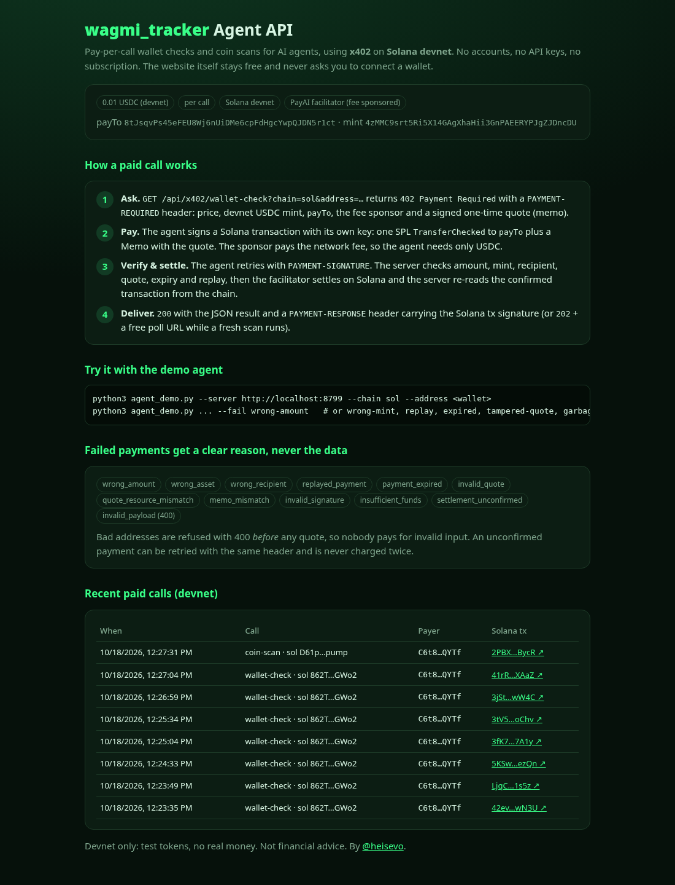
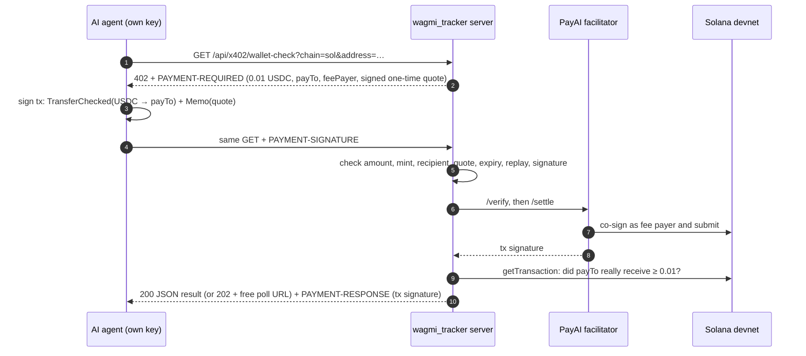

# wagmi_tracker Agent API: pay-per-call wallet intel with x402 on Solana

**by [@heisevo](https://x.com/heisevo)** · Built for the **Encode × Solana Hackathon 2026**, track *Best Use of x402 on Solana*

> ⚠️ **Devnet only.** Every payment in this repo uses Solana **devnet** test USDC. No mainnet, no real money.

## What is wagmi_tracker?

[**wagmi_tracker**](https://wagmi-tracker.onrender.com) is a memecoin and NFT early-buyer tracker for Solana, Ethereum,
Base, Robinhood Chain and Bitcoin. You paste a coin and see who really bought it first, with snipers and bots filtered out.
You paste a wallet and get a verdict: **Copy it**, **Watch for alpha** or **Skip**, plus its win rate, PnL and entry timing.
The website is free and never asks anyone to connect a wallet. More on the app: [`docs/APP.md`](docs/APP.md).

## What was built for the hackathon

People use the website, but the users who need wallet intel most are **trading bots and AI agents**, and they can't sign up
for subscriptions or click through checkouts. So we built an **x402 Agent API**:

- `GET /api/x402/wallet-check?chain=sol&address=<wallet>`: a deep, fresh wallet check
- `GET /api/x402/coin-scan?chain=sol&address=<mint>`: a deep, fresh coin scan (first real buyers, each scored)
- **0.01 devnet USDC per call**, paid inside the HTTP request with x402. No account, no API key, no subscription.
- The agent pays from **its own key** and needs **no SOL**: the PayAI facilitator pays the network fee.

The history shows the split: the first commit is the existing app (pre-hackathon) and the second is everything added for
the hackathon (`x402.py`, `x402_svm.py`, `agent_demo.py`, `x402_setup.py`, `tests/`, `static/agent.html`, `docs/X402.md`,
and a small hook in `server.py`).



## How a paid call works



It follows x402 **v2** over HTTP (`PAYMENT-REQUIRED`, `PAYMENT-SIGNATURE`, `PAYMENT-RESPONSE`; the v1 `X-PAYMENT` names
work too) with the **`exact` scheme on Solana**, as specified in [coinbase/x402](https://github.com/coinbase/x402).
It's implemented in plain Python with [`solders`](https://github.com/kevinheavey/solders), and settlement goes through the
public [PayAI facilitator](https://facilitator.payai.network). A self-sponsored mode (`X402_FACILITATOR=local`) lets the
server pay the fee and submit the transaction itself. Full details: [`docs/X402.md`](docs/X402.md).

## How Solana powers it

- **Settlement:** each call is a real SPL `TransferChecked` of USDC on Solana, confirmed in about a second for a
  fraction of a cent. That's what makes a one-cent API call economical.
- **Gasless agents:** Solana's separate fee-payer signature lets the facilitator pay the fee while the agent only signs
  the token transfer.
- **Receipts:** the transaction signature returned in `PAYMENT-RESPONSE` is a public, verifiable receipt.
- **Binding:** the server's signed quote goes on-chain in a Memo, tying each payment to exactly one request.
- **The product reads Solana too:** wallet checks and coin scans are built from Solana RPC data (pump.fun curves, PumpSwap
  pools, wallet PnL), so agents pay on Solana for Solana intelligence.

## Real devnet transactions

Agent `C6t86bKHdZzXx7tyBdswNXicT82LzpcYSjGjCgTnQYTf` paid payTo `8tJsqvPs45eFEU8Wj6nUiDMe6cpFdHgcYwpQJDN5r1ct`. The
fee payer is PayAI's `2wKupLR9q6wXYppw8Gr2NvWxKBUqm4PPJKkQfoxHDBg4`, and the agent holds 0 SOL.

| Run | Result | Devnet tx |
|---|---|---|
| Wallet check (happy path, recorded) | 200, verdict delivered | [`3jSt7AbuYn…yAwW4C`](https://explorer.solana.com/tx/3jSt7AbuYnGSanoSWbZ1QaMDYSqkxpFdwFtp9yc3imUpVd3GgyCS9CHN9febcD1KYmNYMKZYDL3cYoeYYyAwW4C?cluster=devnet) |
| First end-to-end run | 200 | [`42evez5Bek…CUwN3U`](https://explorer.solana.com/tx/42evez5BekxZ4wcbc51WLb4L79Sy82su7gyEQPUXvwK4viKfatXXDTRhqi8CChqDtsxffibBDbH663CLBKCUwN3U?cluster=devnet) |
| Pay, then replay the same header | 200, then **402 `replayed_payment`**, no second transfer | [`41rRpJLuYj…FMXAaZ`](https://explorer.solana.com/tx/41rRpJLuYjH4DpaLfXq2VvR814KCw1ouBYScUi1KcnFTxppSvgAEPkoRyC1aBYtzdZAAki9jEmGhpEBrJqFMXAaZ?cluster=devnet) |
| Fresh coin scan | 202 + free poll, delivered after the scan | [`2PBXZCi1Mp…ueBycR`](https://explorer.solana.com/tx/2PBXZCi1MpBFaBYaMNnVnkMJ97TjGLnrLkhZqLJLUswHyxtoGxQCYhLNKYiwWVaf1nQfgTu4NY2LEZtr8iueBycR?cluster=devnet) |

Terminal recording: [`docs/media/x402-terminal-demo.mp4`](docs/media/x402-terminal-demo.mp4) · logs: [`docs/x402-demo-logs.md`](docs/x402-demo-logs.md)

## Failure handling

The data is never delivered without a payment that passed every check. A bad address gets `400` **before** any quote, so
nobody pays for invalid input. A failed payment gets `402` with a fresh quote and a clear reason:

`wrong_amount` · `wrong_asset` · `wrong_recipient` · `replayed_payment` · `payment_expired` · `invalid_quote` (edited
quote) · `quote_resource_mismatch` · `memo_mismatch` · `invalid_signature` · `fee_payer_not_isolated` ·
`insufficient_funds` · `settlement_unconfirmed` (retry with the same header; you're never charged twice) ·
`invalid_payload` (400)

All of these except the unconfirmed retry were demonstrated live on devnet (see the logs). The unconfirmed retry, the
replay rules and every verification check are covered by offline unit tests.

## Run it yourself (devnet)

Needs Python 3.11+.

```bash
git clone https://github.com/Nwa-Ani/wagmi_tracker-agent-api && cd wagmi_tracker-agent-api
pip install -r requirements.txt
python3 x402_setup.py keygen        # makes 2 burner devnet keypairs in .secrets/ (gitignored); prints public keys only
```

1. Go to **[faucet.circle.com](https://faucet.circle.com)**, choose **Solana Devnet** and send devnet USDC to **both**
   public keys (the agent and the server). Sending to the server's key also creates its USDC account, so you don't
   need any SOL.
2. Check: `python3 x402_setup.py status`
3. Run the server and the demo agent:

```bash
PORT=8787 python3 server.py                     # x402 agent API: on, via https://facilitator.payai.network
python3 agent_demo.py --address 862TYSvRYoiHAK3F3WwTRYAfuGiQaGdxedN9AGvRGWo2 --fresh 0     # happy path (cached sample result)
python3 agent_demo.py --address 862TYSvRYoiHAK3F3WwTRYAfuGiQaGdxedN9AGvRGWo2 --fresh 0 --fail replay
#   other demos: --fail wrong-amount | wrong-mint | wrong-recipient | expired | tampered-quote | garbage | no-funds
python3 agent_demo.py --endpoint coin-scan --address <pump.fun mint>   # fresh scan: 202 + poll (slow without HELIUS_API_KEY)
python3 -m unittest tests.test_x402 -v          # offline tests, no network or funds needed
```

Open `http://localhost:8787/agent.html` for the docs page and the recent paid calls. Every setting is optional; see
[`.env.example`](.env.example). The main app also runs without any keys, using free public data.

## Repo map

| Path | What |
|---|---|
| `x402.py` | server side: 402 quotes, payload checks, PayAI/local settlement, on-chain confirmation, replay ledger, HTTP routes |
| `x402_svm.py` | shared Solana helpers: builds the exact-scheme payment transaction |
| `agent_demo.py` | demo AI agent that pays per call and prints the whole flow |
| `x402_setup.py` | devnet setup: keygen, status, token accounts, a TEST-token fallback |
| `tests/test_x402.py` | 17 unit tests for the verification logic |
| `static/agent.html` | Agent API docs page |
| `server.py`, `core.py`, `chains/`, `extras.py`, `static/` | the existing wagmi_tracker app |

## License

© 2026 Evo ([@heisevo](https://x.com/heisevo)). All rights reserved. The code is public for hackathon judging and review only; see [LICENSE](LICENSE). Not financial advice.
