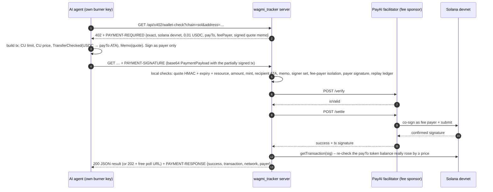

# wagmi_tracker Agent API: pay-per-call wallet intel with x402 on Solana

> Encode × Solana Hackathon 2026, track **Best Use of x402 on Solana**. **Devnet only**: test tokens, no real money.
> Branch `encode-x402`. Not part of the live site.

## What it is

wagmi_tracker tells you whether a memecoin wallet is worth copying (verdict, win rate, PnL, early entries) and who the
first real buyers of a coin were. Humans use the free website. **AI agents and bots** get the same deep, *fresh* scans
through a paid HTTP API, priced at **0.01 USDC per call**, paid with **x402**:

- no account, no API key, no subscription, no checkout page
- the agent pays from **its own key** in the same HTTP request flow
- the website still never asks anyone to connect a wallet

| Endpoint | What you get |
|---|---|
| `GET /api/x402` | Free catalog: price, asset, payTo, network, resources |
| `GET /api/x402/wallet-check?chain=sol&address=<wallet>[&fresh=0]` | **Paid.** Fresh wallet check (verdict / win rate / PnL / paperhands) |
| `GET /api/x402/coin-scan?chain=sol&address=<mint>[&fresh=0]` | **Paid.** Fresh coin scan: first real buyers, snipers/bots filtered |
| `GET /api/x402/job/<token>[?retry=1]` | Free poll for a paid scan that is still running (token comes only with the paid response) |
| `GET /api/x402/recent` | Last paid calls with their devnet transaction links |
| `/agent.html` | Human-readable docs page with the live "recent paid calls" table |

`chain` can be `sol`, `eth`, `base`, `robinhood` or `btc`. Payment is always on Solana devnet.

## The flow



### Which x402 pieces are used (honestly)

- **Protocol:** x402 **v2**, HTTP transport (`PAYMENT-REQUIRED` / `PAYMENT-SIGNATURE` / `PAYMENT-RESPONSE`;
  the v1 names `X-PAYMENT` / `X-PAYMENT-RESPONSE` are also accepted/sent), scheme **`exact` on SVM**, network
  `solana:EtWTRABZaYq6iMfeYKouRu166VU2xqa1` (devnet). Transaction layout follows the reference "static" path of
  `specs/schemes/exact/scheme_exact_svm.md` in `coinbase/x402`.
- **Facilitator (default):** the public **PayAI facilitator** `https://facilitator.payai.network` (`/supported`,
  `/verify`, `/settle`). It is the fee payer, so the agent needs **no SOL**, only devnet USDC. Its devnet fee payer is
  read live from `/supported`.
- **Self-sponsored mode (fallback):** `X402_FACILITATOR=local` makes this server the fee payer: it co-signs, simulates,
  submits and confirms through a devnet RPC itself (needs the server burner key and a little devnet SOL).
- **Implementation:** pure Python with `solders` (no x402 SDK; the official SDKs are TypeScript/Go/Python-EVM-first).
  Server: `x402.py`, shared tx helpers: `x402_svm.py`, client: `agent_demo.py`.
- **Independent on-chain check:** whatever the facilitator says, the server only delivers after it has read the
  confirmed transaction from Solana and seen the payTo token account rise by at least the price.

## How Solana powers it

- **Settlement layer:** every paid call is a real SPL `TransferChecked` of USDC on Solana, confirmed in ~1 s at a
  fraction of a cent. That is what makes 0.01-per-call pricing viable; on most chains the fee would exceed the price.
- **Gasless for the agent:** Solana's separate fee-payer signature lets the facilitator pay the network fee while the
  agent only signs the token transfer.
- **Receipts:** the tx signature in `PAYMENT-RESPONSE` is a public, verifiable receipt (Solana Explorer link).
- **Memo program:** each quote is written on-chain in a Memo, binding the payment to one specific request.
- **The product itself reads Solana:** wallet checks and coin scans are built from Solana RPC data (early buyers on
  pump.fun curves, wallet PnL), so agents pay on Solana to get Solana intelligence.

## Live devnet proof (Oct 18, 2026, Lagos time / WAT)

Run against the **PayAI facilitator** on Solana devnet with the burner wallets
agent `C6t86bKHdZzXx7tyBdswNXicT82LzpcYSjGjCgTnQYTf` → payTo `8tJsqvPs45eFEU8Wj6nUiDMe6cpFdHgcYwpQJDN5r1ct`
(USDC token account `4fbDubXmkd1ARxdoMHTtEuKNxmUS66Rt1DnuWHHGfn2p`). Each payment is one 0.01 devnet-USDC
`TransferChecked` + the server's quote Memo; the fee (10,001 lamports) was paid by PayAI's fee payer
`2wKupLR9q6wXYppw8Gr2NvWxKBUqm4PPJKkQfoxHDBg4`, so the agent holds **0 SOL**.

| Run | Result | Devnet tx |
|---|---|---|
| Happy path, wallet-check (recorded) | 200, verdict delivered, on-chain check passed | [`3jSt7Abu…yAwW4C`](https://explorer.solana.com/tx/3jSt7AbuYnGSanoSWbZ1QaMDYSqkxpFdwFtp9yc3imUpVd3GgyCS9CHN9febcD1KYmNYMKZYDL3cYoeYYyAwW4C?cluster=devnet) |
| First end-to-end run | 200 | [`42evez5B…CUwN3U`](https://explorer.solana.com/tx/42evez5BekxZ4wcbc51WLb4L79Sy82su7gyEQPUXvwK4viKfatXXDTRhqi8CChqDtsxffibBDbH663CLBKCUwN3U?cluster=devnet) |
| Replay demo: pay, then resend the same header | 200, then **402 `replayed_payment`**, no second transfer | [`41rRpJLu…FMXAaZ`](https://explorer.solana.com/tx/41rRpJLuYjH4DpaLfXq2VvR814KCw1ouBYScUi1KcnFTxppSvgAEPkoRyC1aBYtzdZAAki9jEmGhpEBrJqFMXAaZ?cluster=devnet) |
| Replay demo (earlier run) | same | [`LjqCC6Rz…9f1s5z`](https://explorer.solana.com/tx/LjqCC6RzzRnpRoYaQkp7CnERiaWJLFDmjmnRYc5aHN3PRWtLZG7dExF1yk3hr1zNJ2x3skuZPJTVgNw5f9f1s5z?cluster=devnet) |
| Fresh coin-scan (202 + free poll) | paid, scan ran after settlement | [`2PBXZCi1…ueBycR`](https://explorer.solana.com/tx/2PBXZCi1MpBFaBYaMNnVnkMJ97TjGLnrLkhZqLJLUswHyxtoGxQCYhLNKYiwWVaf1nQfgTu4NY2LEZtr8iueBycR?cluster=devnet) |

**No double charge:** the server's USDC account shows exactly one incoming transfer per delivered call (8 paid calls,
agent 20 → 19.92, server 20 → 20.08) and none for any replay or failure demo.

Failure demos run live against the same server (nothing delivered, no funds moved):
`wrong_amount` (paid 0.005), `wrong_asset` (wrong mint), `wrong_recipient` (paid someone else), `invalid_quote`
(agent edited the quote expiry), `payment_expired` (paid after the 120 s quote expired), `invalid_payload` (400,
garbage header), `insufficient_funds` (brand-new empty wallet, rejected by PayAI's simulation) and
`replayed_payment` (above). Recordings and logs: [`docs/x402-demo-logs.md`](x402-demo-logs.md), [`docs/media/x402-terminal-demo.mp4`](media/x402-terminal-demo.mp4).

> Lesson learned: the quote Memo costs ~25k compute units, so the client sets a 40k CU limit (PayAI rejects very
> high limits and a 20k limit runs out of compute).

## Failure handling

Nothing is ever delivered without a payment that passed every check. Invalid input is refused with `400` **before**
a quote is made, so nobody pays for a bad address. Payment failures answer `402` with a fresh `PAYMENT-REQUIRED`
header and a JSON body `{reason, error, accepts…}`:

| reason | When |
|---|---|
| `invalid_payload` / `invalid_transaction` (400) | header isn't base64 JSON, or the tx can't be decoded |
| `invalid_x402_version`, `unsupported_scheme`, `invalid_network` | not v2 / not `exact` / not devnet (mainnet is refused) |
| `invalid_quote` | the memo wasn't issued by this server, or someone edited price/expiry (HMAC mismatch) |
| `quote_resource_mismatch` | paying with a quote for a different endpoint/address |
| `payment_expired` | quote older than `maxTimeoutSeconds`, or the tx blockhash expired |
| `wrong_amount` | transfer below the price (overpaying is tolerated per spec) |
| `wrong_asset` | not the devnet USDC mint |
| `wrong_recipient` | not payTo's associated token account |
| `memo_mismatch` | missing or different memo |
| `invalid_signature` | the payer's signature is missing or invalid |
| `fee_payer_mismatch` / `fee_payer_not_isolated` | tx tries to use the sponsor for anything but fees |
| `replayed_payment` | the same quote or same signed tx was already used for a delivered call |
| `insufficient_funds` | payer has no USDC account or too little balance (from facilitator simulation) |
| `settlement_unconfirmed` | submitted but not confirmed in time; **retry with the same header**: the server re-checks the chain and never charges twice |
| `payment_in_progress` (409) | the same payment is being processed concurrently |

If a paid scan itself fails, the free poll URL offers **one free re-run** (`?retry=1`). Quotes are stateless
(HMAC-signed memo), and used quotes / tx hashes are kept in a persisted replay ledger (`cache/x402_ledger.json`).

## Setup (devnet)

```bash
pip install -r requirements.txt
# 1. burner keypairs (gitignored, never printed or committed)
#    .secrets/server_payto.json  (payTo)    .secrets/agent_payer.json  (demo agent)
python3 x402_setup.py status                   # shows public keys + balances
# 2. fund with devnet USDC: https://faucet.circle.com  → "Solana Devnet", paste EACH public key (agent and server).
#    Sending faucet USDC to the server address also creates its token account, so no SOL is needed with PayAI.
#    (If you have devnet SOL instead: python3 x402_setup.py ata  creates the server's USDC account.)
# 3. run the server and the agent
PORT=8787 python3 server.py
python3 agent_demo.py --server http://localhost:8787 --chain sol --address <wallet> --fresh 0
python3 agent_demo.py --server http://localhost:8787 --chain sol --address <wallet> --fail replay
python3 -m unittest tests.test_x402 -v         # offline tests of the verification logic
```

Environment variables (all optional):

| var | default | |
|---|---|---|
| `X402_PAY_TO` | pubkey of `.secrets/server_payto.json` | public key that receives payments |
| `X402_FACILITATOR` | `payai` | `payai`, `local` (self-sponsored), or any facilitator URL |
| `X402_FEEPAYER_SECRET` | `.secrets/server_payto.json` | only for `local` mode |
| `X402_ASSET` / `X402_DECIMALS` | devnet USDC `4zMMC9…DncDU` / 6 | `x402_setup.py test-token` makes a labelled devnet TEST stand-in if USDC is unavailable |
| `X402_PRICE` | `10000` (= 0.01) | atomic units |
| `X402_TIMEOUT` | `120` | quote lifetime, seconds |
| `X402_WAIT` | `20` | seconds a paid call waits for the scan before answering 202 + poll URL |
| `X402_SECRET` | `.secrets/x402_hmac` | HMAC key for quotes |
| `DEVNET_RPC` | Helius devnet if `HELIUS_API_KEY`, else public devnet | |

## Demo video script (≈3 min)

| Time | Show | Say |
|---|---|---|
| 0:00–0:20 | Live site, paste a wallet, verdict appears | "This is wagmi_tracker. Paste any memecoin wallet and it tells you: copy it, watch it, or skip. Humans use it free, no wallet connect." |
| 0:20–0:40 | `/agent.html` | "But the real users of wallet intel are trading agents. They can't sign up for subscriptions. So we gave them x402: pay a cent per call on Solana, in the HTTP request itself." |
| 0:40–1:20 | Terminal recording `x402-terminal-demo.mp4` (or a live `agent_demo.py` run), steps 1–2 | "The agent asks for a fresh wallet check. The server answers 402 Payment Required: 0.01 devnet USDC, our payTo, PayAI as fee sponsor, and a one-time quote. The agent signs one USDC transfer with its own burner key. It needs no SOL; the facilitator pays the fee." |
| 1:20–1:55 | Step 3–4 output, click Explorer link | "It retries with the payment header. We check amount, mint, recipient, quote and replay, PayAI settles on Solana, and we re-read the confirmed tx from the chain before delivering. Here's the transaction on Solana Explorer, and here's the verdict JSON." |
| 1:55–2:35 | `--fail wrong-amount`, `--fail replay`, `--fail expired` | "Failures are first-class. Underpay: 402 wrong_amount. Replay the same payment: replayed_payment. Stale quote: payment_expired. The data is never delivered without a valid payment, and an unconfirmed payment can be retried without paying twice." |
| 2:35–3:00 | `/agent.html` recent paid calls, `docs/X402.md` | "Every paid call is a public Solana receipt. Solana makes one-cent API calls economical and gasless for the agent. That's wagmi_tracker's Agent API." |
